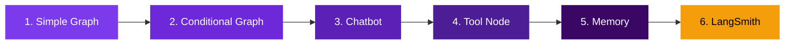

<div align="center">


<a href="https://github.com/rushikreddie/langgraph">
  
</a>

<br/>


</div>

---

## ✨ About

A hands-on, notebook-based walkthrough of **LangGraph**: starting from a minimal graph and building up to a chatbot with tools, memory, and observability. Each notebook adds one new concept, so you can follow along in order.

---

## 🗺️ Learning Path



| # | Notebook | What you learn |
|---|----------|----------------|
| 1 | [`1_simple_graph.ipynb`](1_simple_graph.ipynb) | Nodes, edges, state, and compiling your first graph |
| 2 | [`2_condition_graph.ipynb`](2_condition_graph.ipynb) | Conditional edges and routing logic |
| 3 | [`3_chatbot.ipynb`](3_chatbot.ipynb) | A conversational chatbot built with LangGraph |
| 4 | [`4_tool_node.ipynb`](4_tool_node.ipynb) | Giving the LLM tools through a tool node |
| 5 | [`5_memory.ipynb`](5_memory.ipynb) | Persisting conversation state across turns |
| 6 | [`6_langsmith.ipynb`](6_langsmith.ipynb) | Tracing and debugging runs with LangSmith |

---

## 📁 Project Structure

```text
langgraph/
├── 1_simple_graph.ipynb
├── 2_condition_graph.ipynb
├── 3_chatbot.ipynb
├── 4_tool_node.ipynb
├── 5_memory.ipynb
├── 6_langsmith.ipynb
├── main.py
├── src/
│   └── 3_langgraph/
│       └── __init__.py
├── .python-version
└── README.md
```

---

## 📋 Requirements

- **Python**: the version listed in [`.python-version`](.python-version)
- **[uv](https://docs.astral.sh/uv/)**: package manager (`pip install uv` or see the uv docs)
- **Git**: to clone the repository
- **API keys**:
  - A [Groq](https://console.groq.com/) API key for the LLM
  - A [LangSmith](https://smith.langchain.com/) API key (optional, for tracing)
- **Main packages**: `langgraph`, `langchain`, `langsmith`, `jupyter`, `python-dotenv` (the exact versions are in `pyproject.toml`)

---

## 🚀 Getting Started

### 1. Clone the repository

```bash
git clone https://github.com/rushikreddie/langgraph.git
cd langgraph
```

### 2. Install dependencies with [uv](https://docs.astral.sh/uv/)

```bash
uv sync
```

### 3. Set up your environment variables

Create a `.env` file in the project root:

```env
GROQ_API_KEY=your_groq_api_key

# LangSmith (optional, for tracing)
LANGSMITH_TRACING=true
LANGSMITH_ENDPOINT=https://api.smith.langchain.com
LANGSMITH_API_KEY=your_langsmith_api_key
```

> ⚠️ Never commit your `.env` file. Keep it listed in `.gitignore`.

### 4. Run the notebooks

```bash
uv run jupyter lab
```

Open the notebooks in order, starting with `1_simple_graph.ipynb`.

---

## 🧰 Tech Stack

- **LangGraph**: stateful, graph-based agent workflows
- **LangChain**: LLM and tool integrations
- **LangSmith**: tracing and observability
- **Python + uv**: language and fast dependency management
- **Jupyter**: interactive learning notebooks

---

## 🤝 Contributing

Suggestions and improvements are welcome. Feel free to open an issue or submit a pull request.

---

<div align="center">

**Made with ❤️ by [Rushik Reddy](https://github.com/rushikreddie)**

If this helped you, consider giving the repo a ⭐


</div>
